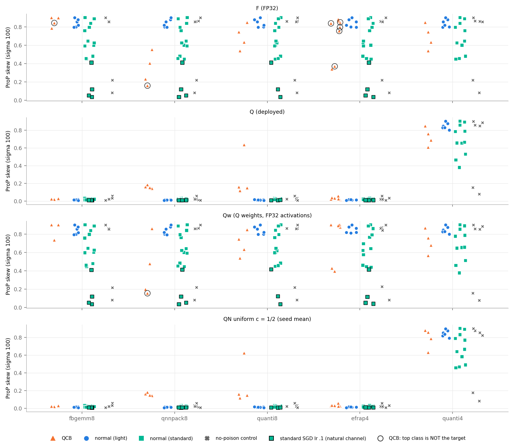
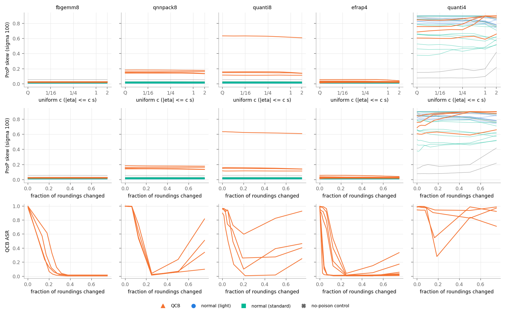
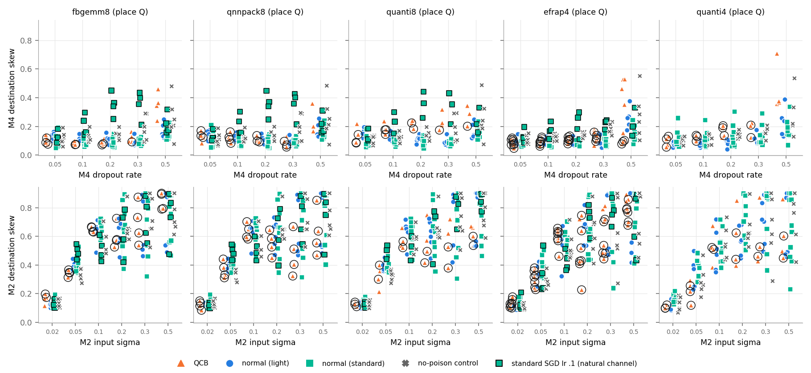

# E01 readout 20261125-0912Z

run `E01_20261125_001`: 217/300 jobs done, 0 errors. Models with a Q row per recipe: efrap4 36, fbgemm8 32, qnnpack8 32, quanti4 27, quanti8 31

## M3 (ProP sigma 100) skew: QCB cell vs normal + control range on the same recipe

| recipe | cell | place | QCB n | QCB values | normal+ctrl n | normal+ctrl min | normal+ctrl median | normal+ctrl max | QCB above all | QCB below all |
|---|---|---|---|---|---|---|---|---|---|---|
| fbgemm8 | Ma-8 | F | 4 | 0.784, 0.841, 0.897, 0.899 | 28 | 0.036 | 0.776 | 0.900 | 0/4 | 0/4 |
| fbgemm8 | Ma-8 | Q | 4 | 0.018, 0.022, 0.024, 0.027 | 28 | 0.005 | 0.014 | 0.056 | 0/4 | 0/4 |
| fbgemm8 | Ma-8 | Qw | 4 | 0.734, 0.900, 0.900, 0.900 | 28 | 0.035 | 0.774 | 0.900 | 0/4 | 0/4 |
| fbgemm8 | Ma-8 | U0.25 | 4 | 0.018, 0.022, 0.024, 0.029 | 28 | 0.006 | 0.015 | 0.056 | 0/4 | 0/4 |
| fbgemm8 | Ma-8 | U0.5 | 4 | 0.018, 0.022, 0.025, 0.029 | 28 | 0.006 | 0.015 | 0.057 | 0/4 | 0/4 |
| fbgemm8 | Ma-8 | U1 | 4 | 0.018, 0.022, 0.025, 0.029 | 28 | 0.006 | 0.015 | 0.057 | 0/4 | 0/4 |
| fbgemm8 | Ma-8 | stoch | 4 | 0.018, 0.022, 0.024, 0.029 | 28 | 0.006 | 0.015 | 0.057 | 0/4 | 0/4 |
| qnnpack8 | Tian-8 | F | 4 | 0.159, 0.230, 0.402, 0.551 | 28 | 0.036 | 0.776 | 0.900 | 0/4 | 0/4 |
| qnnpack8 | Tian-8 | Q | 4 | 0.141, 0.151, 0.160, 0.183 | 28 | 0.006 | 0.014 | 0.056 | 4/4 | 0/4 |
| qnnpack8 | Tian-8 | Qw | 4 | 0.154, 0.197, 0.476, 0.859 | 28 | 0.036 | 0.776 | 0.900 | 0/4 | 0/4 |
| qnnpack8 | Tian-8 | U0.25 | 4 | 0.142, 0.148, 0.161, 0.182 | 28 | 0.006 | 0.015 | 0.056 | 4/4 | 0/4 |
| qnnpack8 | Tian-8 | U0.5 | 4 | 0.143, 0.148, 0.162, 0.180 | 28 | 0.005 | 0.015 | 0.056 | 4/4 | 0/4 |
| qnnpack8 | Tian-8 | U1 | 4 | 0.140, 0.145, 0.163, 0.180 | 28 | 0.005 | 0.015 | 0.056 | 4/4 | 0/4 |
| qnnpack8 | Tian-8 | stoch | 4 | 0.143, 0.149, 0.163, 0.181 | 28 | 0.006 | 0.015 | 0.057 | 4/4 | 0/4 |
| quanti8 | QuANTI-8+4 | F | 4 | 0.538, 0.632, 0.743, 0.847 | 27 | 0.036 | 0.794 | 0.900 | 0/4 | 0/4 |
| quanti8 | QuANTI-8+4 | Q | 4 | 0.116, 0.148, 0.158, 0.635 | 27 | 0.006 | 0.015 | 0.056 | 4/4 | 0/4 |
| quanti8 | QuANTI-8+4 | Qw | 4 | 0.537, 0.632, 0.744, 0.847 | 27 | 0.036 | 0.794 | 0.900 | 0/4 | 0/4 |
| quanti8 | QuANTI-8+4 | U0.25 | 4 | 0.114, 0.148, 0.160, 0.630 | 27 | 0.006 | 0.015 | 0.057 | 4/4 | 0/4 |
| quanti8 | QuANTI-8+4 | U0.5 | 4 | 0.116, 0.146, 0.159, 0.623 | 27 | 0.006 | 0.015 | 0.057 | 4/4 | 0/4 |
| quanti8 | QuANTI-8+4 | U1 | 4 | 0.114, 0.145, 0.151, 0.616 | 27 | 0.006 | 0.015 | 0.057 | 4/4 | 0/4 |
| quanti8 | QuANTI-8+4 | stoch | 4 | 0.115, 0.146, 0.152, 0.630 | 27 | 0.006 | 0.016 | 0.057 | 4/4 | 0/4 |
| efrap4 | Ma-W4A4 | F | 4 | 0.755, 0.794, 0.837, 0.849 | 28 | 0.036 | 0.776 | 0.900 | 0/4 | 0/4 |
| efrap4 | Ma-W4A4 | Q | 4 | 0.012, 0.015, 0.019, 0.021 | 28 | 0.006 | 0.015 | 0.056 | 0/4 | 0/4 |
| efrap4 | Ma-W4A4 | Qw | 4 | 0.874, 0.900, 0.900, 0.900 | 28 | 0.040 | 0.777 | 0.900 | 0/4 | 0/4 |
| efrap4 | Ma-W4A4 | U0.25 | 4 | 0.017, 0.021, 0.022, 0.028 | 28 | 0.006 | 0.015 | 0.057 | 0/4 | 0/4 |
| efrap4 | Ma-W4A4 | U0.5 | 4 | 0.018, 0.021, 0.022, 0.027 | 28 | 0.006 | 0.015 | 0.056 | 0/4 | 0/4 |
| efrap4 | Ma-W4A4 | U1 | 4 | 0.018, 0.021, 0.022, 0.027 | 28 | 0.006 | 0.015 | 0.051 | 0/4 | 0/4 |
| efrap4 | Ma-W4A4 | stoch | 4 | 0.018, 0.021, 0.023, 0.028 | 28 | 0.006 | 0.015 | 0.056 | 0/4 | 0/4 |
| efrap4 | Tian-W4A4 | F | 4 | 0.339, 0.369, 0.864, 0.881 | 28 | 0.036 | 0.776 | 0.900 | 0/4 | 0/4 |
| efrap4 | Tian-W4A4 | Q | 4 | 0.024, 0.032, 0.038, 0.056 | 28 | 0.006 | 0.015 | 0.056 | 1/4 | 0/4 |
| efrap4 | Tian-W4A4 | Qw | 4 | 0.394, 0.427, 0.886, 0.892 | 28 | 0.040 | 0.777 | 0.900 | 0/4 | 0/4 |
| efrap4 | Tian-W4A4 | U0.25 | 4 | 0.022, 0.031, 0.036, 0.057 | 28 | 0.006 | 0.015 | 0.057 | 0/4 | 0/4 |
| efrap4 | Tian-W4A4 | U0.5 | 4 | 0.022, 0.030, 0.034, 0.057 | 28 | 0.006 | 0.015 | 0.056 | 1/4 | 0/4 |
| efrap4 | Tian-W4A4 | U1 | 4 | 0.022, 0.029, 0.034, 0.052 | 28 | 0.006 | 0.015 | 0.051 | 1/4 | 0/4 |
| efrap4 | Tian-W4A4 | stoch | 4 | 0.024, 0.031, 0.033, 0.060 | 28 | 0.006 | 0.015 | 0.056 | 1/4 | 0/4 |
| quanti4 | QuANTI-8+4 | F | 4 | 0.538, 0.632, 0.743, 0.847 | 23 | 0.080 | 0.797 | 0.900 | 0/4 | 0/4 |
| quanti4 | QuANTI-8+4 | Q | 4 | 0.606, 0.686, 0.758, 0.846 | 23 | 0.077 | 0.826 | 0.900 | 0/4 | 0/4 |
| quanti4 | QuANTI-8+4 | Qw | 4 | 0.565, 0.677, 0.757, 0.865 | 23 | 0.076 | 0.824 | 0.900 | 0/4 | 0/4 |
| quanti4 | QuANTI-8+4 | U0.25 | 4 | 0.620, 0.716, 0.790, 0.861 | 23 | 0.078 | 0.802 | 0.900 | 0/4 | 0/4 |
| quanti4 | QuANTI-8+4 | U0.5 | 4 | 0.630, 0.785, 0.857, 0.878 | 23 | 0.081 | 0.816 | 0.900 | 0/4 | 0/4 |
| quanti4 | QuANTI-8+4 | U1 | 4 | 0.590, 0.896, 0.898, 0.900 | 23 | 0.098 | 0.801 | 0.900 | 0/4 | 0/4 |
| quanti4 | QuANTI-8+4 | stoch | 4 | 0.575, 0.781, 0.852, 0.883 | 23 | 0.074 | 0.815 | 0.900 | 0/4 | 0/4 |

QCB top class = target (M3 sigma 100), per cell and recipe:

| cell | recipe | F | Q | Qw |
|---|---|---|---|---|
| Ma-8 | fbgemm8 | 3/4 | 4/4 | 4/4 |
| Ma-W4A4 | efrap4 | 0/4 | 4/4 | 4/4 |
| QuANTI-8+4 | quanti4 | 4/4 | 4/4 | 4/4 |
| QuANTI-8+4 | quanti8 | 4/4 | 4/4 | 4/4 |
| Tian-8 | qnnpack8 | 3/4 | 4/4 | 3/4 |
| Tian-W4A4 | efrap4 | 3/4 | 4/4 | 4/4 |

## ProP raw score (1 - benign, sigma 100)

| recipe | cell | place | QCB n | QCB values | normal+ctrl n | normal+ctrl min | normal+ctrl median | normal+ctrl max | QCB above all | QCB below all |
|---|---|---|---|---|---|---|---|---|---|---|
| fbgemm8 | Ma-8 | F | 4 | 0.984, 0.996, 1.000, 1.000 | 28 | 0.194 | 0.985 | 1.000 | 0/4 | 0/4 |
| fbgemm8 | Ma-8 | Q | 4 | 0.386, 0.392, 0.479, 0.508 | 28 | 0.141 | 0.256 | 0.496 | 1/4 | 0/4 |
| fbgemm8 | Ma-8 | Qw | 4 | 0.965, 1.000, 1.000, 1.000 | 28 | 0.192 | 0.985 | 1.000 | 0/4 | 0/4 |
| fbgemm8 | Ma-8 | U0.5 | 4 | 0.380, 0.426, 0.477, 0.505 | 28 | 0.141 | 0.255 | 0.491 | 1/4 | 0/4 |
| qnnpack8 | Tian-8 | F | 4 | 0.402, 0.522, 0.725, 0.870 | 28 | 0.194 | 0.985 | 1.000 | 0/4 | 0/4 |
| qnnpack8 | Tian-8 | Q | 4 | 0.501, 0.650, 0.804, 0.883 | 28 | 0.149 | 0.241 | 0.519 | 3/4 | 0/4 |
| qnnpack8 | Tian-8 | Qw | 4 | 0.386, 0.439, 0.815, 0.999 | 28 | 0.197 | 0.985 | 1.000 | 0/4 | 0/4 |
| qnnpack8 | Tian-8 | U0.5 | 4 | 0.488, 0.656, 0.807, 0.886 | 28 | 0.139 | 0.254 | 0.491 | 3/4 | 0/4 |
| quanti8 | QuANTI-8+4 | F | 4 | 0.978, 0.980, 0.994, 0.999 | 27 | 0.194 | 0.987 | 1.000 | 0/4 | 0/4 |
| quanti8 | QuANTI-8+4 | Q | 4 | 0.513, 0.675, 0.806, 0.987 | 27 | 0.145 | 0.265 | 0.504 | 4/4 | 0/4 |
| quanti8 | QuANTI-8+4 | Qw | 4 | 0.978, 0.980, 0.994, 0.999 | 27 | 0.197 | 0.987 | 1.000 | 0/4 | 0/4 |
| quanti8 | QuANTI-8+4 | U0.5 | 4 | 0.508, 0.679, 0.811, 0.986 | 27 | 0.142 | 0.257 | 0.492 | 4/4 | 0/4 |
| efrap4 | Ma-W4A4 | F | 4 | 0.982, 0.994, 0.997, 0.997 | 28 | 0.194 | 0.985 | 1.000 | 0/4 | 0/4 |
| efrap4 | Ma-W4A4 | Q | 4 | 0.279, 0.323, 0.359, 0.359 | 28 | 0.143 | 0.265 | 0.503 | 0/4 | 0/4 |
| efrap4 | Ma-W4A4 | Qw | 4 | 0.999, 1.000, 1.000, 1.000 | 28 | 0.230 | 0.988 | 1.000 | 0/4 | 0/4 |
| efrap4 | Ma-W4A4 | U0.5 | 4 | 0.312, 0.360, 0.444, 0.521 | 28 | 0.142 | 0.260 | 0.494 | 1/4 | 0/4 |
| efrap4 | Tian-W4A4 | F | 4 | 0.586, 0.595, 0.999, 1.000 | 28 | 0.194 | 0.985 | 1.000 | 0/4 | 0/4 |
| efrap4 | Tian-W4A4 | Q | 4 | 0.314, 0.521, 0.636, 0.771 | 28 | 0.143 | 0.265 | 0.503 | 3/4 | 0/4 |
| efrap4 | Tian-W4A4 | Qw | 4 | 0.629, 0.733, 1.000, 1.000 | 28 | 0.230 | 0.988 | 1.000 | 0/4 | 0/4 |
| efrap4 | Tian-W4A4 | U0.5 | 4 | 0.280, 0.465, 0.629, 0.765 | 28 | 0.142 | 0.260 | 0.494 | 2/4 | 0/4 |
| quanti4 | QuANTI-8+4 | F | 4 | 0.978, 0.980, 0.994, 0.999 | 23 | 0.511 | 0.993 | 1.000 | 0/4 | 0/4 |
| quanti4 | QuANTI-8+4 | Q | 4 | 0.980, 0.991, 0.994, 0.999 | 23 | 0.395 | 0.994 | 1.000 | 0/4 | 0/4 |
| quanti4 | QuANTI-8+4 | Qw | 4 | 0.978, 0.987, 0.994, 1.000 | 23 | 0.408 | 0.993 | 1.000 | 0/4 | 0/4 |
| quanti4 | QuANTI-8+4 | U0.5 | 4 | 0.978, 0.996, 1.000, 1.000 | 23 | 0.432 | 0.989 | 1.000 | 0/4 | 0/4 |

## M4 / M2 destination skew (places F, Q, QN uniform c=1/2 seed 0)

| measure | recipe | cell | place | QCB n | QCB values | normal+ctrl n | normal+ctrl min | normal+ctrl median | normal+ctrl max | QCB above all | QCB below all |
|---|---|---|---|---|---|---|---|---|---|---|---|
| m4 p0.05 | qnnpack8 | Tian-8 | F | 4 | 0.081, 0.108, 0.136, 0.190 | 28 | 0.048 | 0.116 | 0.184 | 1/4 | 0/4 |
| m4 p0.05 | quanti8 | QuANTI-8+4 | Q | 4 | 0.084, 0.088, 0.143, 0.218 | 27 | 0.057 | 0.116 | 0.194 | 1/4 | 0/4 |
| m4 p0.05 | efrap4 | Tian-W4A4 | Q | 4 | 0.047, 0.073, 0.081, 0.107 | 28 | 0.060 | 0.097 | 0.196 | 0/4 | 1/4 |
| m4 p0.05 | quanti4 | QuANTI-8+4 | U0.5 | 4 | 0.183, 0.205, 0.256, 0.294 | 23 | 0.042 | 0.088 | 0.171 | 4/4 | 0/4 |
| m4 p0.1 | qnnpack8 | Tian-8 | U0.5 | 4 | 0.056, 0.075, 0.110, 0.171 | 28 | 0.064 | 0.112 | 0.309 | 0/4 | 1/4 |
| m4 p0.1 | quanti4 | QuANTI-8+4 | F | 4 | 0.139, 0.179, 0.182, 0.212 | 23 | 0.048 | 0.105 | 0.189 | 1/4 | 0/4 |
| m4 p0.1 | quanti4 | QuANTI-8+4 | U0.5 | 4 | 0.208, 0.242, 0.364, 0.367 | 23 | 0.063 | 0.115 | 0.226 | 3/4 | 0/4 |
| m4 p0.2 | qnnpack8 | Tian-8 | F | 4 | 0.051, 0.095, 0.103, 0.145 | 28 | 0.055 | 0.109 | 0.445 | 0/4 | 1/4 |
| m4 p0.2 | qnnpack8 | Tian-8 | U0.5 | 4 | 0.047, 0.080, 0.099, 0.131 | 28 | 0.054 | 0.107 | 0.453 | 0/4 | 1/4 |
| m4 p0.2 | quanti4 | QuANTI-8+4 | F | 4 | 0.187, 0.212, 0.228, 0.234 | 23 | 0.055 | 0.097 | 0.197 | 3/4 | 0/4 |
| m4 p0.2 | quanti4 | QuANTI-8+4 | U0.5 | 4 | 0.252, 0.260, 0.391, 0.551 | 23 | 0.070 | 0.124 | 0.269 | 2/4 | 0/4 |
| m4 p0.3 | qnnpack8 | Tian-8 | F | 4 | 0.052, 0.059, 0.094, 0.109 | 28 | 0.064 | 0.101 | 0.428 | 0/4 | 2/4 |
| m4 p0.3 | qnnpack8 | Tian-8 | Q | 4 | 0.056, 0.070, 0.096, 0.136 | 28 | 0.063 | 0.101 | 0.427 | 0/4 | 1/4 |
| m4 p0.3 | qnnpack8 | Tian-8 | U0.5 | 4 | 0.047, 0.059, 0.098, 0.104 | 28 | 0.057 | 0.099 | 0.442 | 0/4 | 1/4 |
| m4 p0.3 | efrap4 | Ma-W4A4 | F | 4 | 0.060, 0.087, 0.095, 0.126 | 28 | 0.064 | 0.101 | 0.428 | 0/4 | 1/4 |
| m4 p0.3 | quanti4 | QuANTI-8+4 | U0.5 | 4 | 0.371, 0.402, 0.440, 0.702 | 23 | 0.081 | 0.159 | 0.307 | 4/4 | 0/4 |
| m4 p0.5 | qnnpack8 | Tian-8 | F | 4 | 0.061, 0.085, 0.110, 0.155 | 28 | 0.074 | 0.177 | 0.483 | 0/4 | 1/4 |
| m4 p0.5 | efrap4 | Tian-W4A4 | Q | 4 | 0.078, 0.094, 0.102, 0.154 | 28 | 0.078 | 0.198 | 0.551 | 0/4 | 1/4 |
| m4 p0.5 | quanti4 | QuANTI-8+4 | Q | 4 | 0.357, 0.366, 0.375, 0.708 | 23 | 0.069 | 0.206 | 0.535 | 1/4 | 0/4 |
| m4 p0.5 | quanti4 | QuANTI-8+4 | U0.5 | 4 | 0.498, 0.628, 0.781, 0.785 | 23 | 0.092 | 0.220 | 0.635 | 2/4 | 0/4 |
| m2 s0.02 | fbgemm8 | Ma-8 | F | 4 | 0.114, 0.138, 0.158, 0.181 | 28 | 0.092 | 0.129 | 0.173 | 1/4 | 0/4 |
| m2 s0.02 | fbgemm8 | Ma-8 | Q | 4 | 0.115, 0.166, 0.174, 0.198 | 28 | 0.097 | 0.129 | 0.192 | 1/4 | 0/4 |
| m2 s0.02 | qnnpack8 | Tian-8 | F | 4 | 0.081, 0.092, 0.117, 0.121 | 28 | 0.092 | 0.129 | 0.173 | 0/4 | 1/4 |
| m2 s0.02 | qnnpack8 | Tian-8 | Q | 4 | 0.085, 0.115, 0.135, 0.150 | 28 | 0.098 | 0.124 | 0.194 | 0/4 | 1/4 |
| m2 s0.02 | qnnpack8 | Tian-8 | U0.5 | 4 | 0.073, 0.096, 0.114, 0.143 | 28 | 0.079 | 0.127 | 0.202 | 0/4 | 1/4 |
| m2 s0.02 | efrap4 | Ma-W4A4 | U0.5 | 4 | 0.124, 0.127, 0.128, 0.216 | 28 | 0.072 | 0.115 | 0.183 | 1/4 | 0/4 |
| m2 s0.02 | efrap4 | Tian-W4A4 | F | 4 | 0.111, 0.120, 0.124, 0.175 | 28 | 0.092 | 0.129 | 0.173 | 1/4 | 0/4 |
| m2 s0.02 | efrap4 | Tian-W4A4 | U0.5 | 4 | 0.069, 0.114, 0.132, 0.153 | 28 | 0.072 | 0.115 | 0.183 | 0/4 | 1/4 |
| m2 s0.05 | quanti8 | QuANTI-8+4 | F | 4 | 0.223, 0.330, 0.375, 0.410 | 27 | 0.278 | 0.380 | 0.544 | 0/4 | 1/4 |
| m2 s0.05 | quanti8 | QuANTI-8+4 | Q | 4 | 0.213, 0.301, 0.358, 0.399 | 27 | 0.273 | 0.377 | 0.537 | 0/4 | 1/4 |
| m2 s0.05 | quanti8 | QuANTI-8+4 | U0.5 | 4 | 0.260, 0.302, 0.339, 0.400 | 27 | 0.279 | 0.386 | 0.544 | 0/4 | 1/4 |
| m2 s0.05 | efrap4 | Ma-W4A4 | Q | 4 | 0.228, 0.317, 0.329, 0.379 | 28 | 0.230 | 0.330 | 0.535 | 0/4 | 1/4 |
| m2 s0.05 | efrap4 | Tian-W4A4 | F | 4 | 0.256, 0.330, 0.360, 0.524 | 28 | 0.278 | 0.381 | 0.544 | 0/4 | 1/4 |
| m2 s0.05 | quanti4 | QuANTI-8+4 | F | 4 | 0.223, 0.330, 0.375, 0.410 | 23 | 0.278 | 0.373 | 0.529 | 0/4 | 1/4 |
| m2 s0.05 | quanti4 | QuANTI-8+4 | Q | 4 | 0.119, 0.215, 0.256, 0.292 | 23 | 0.176 | 0.322 | 0.497 | 0/4 | 1/4 |
| m2 s0.1 | fbgemm8 | Ma-8 | F | 4 | 0.631, 0.691, 0.706, 0.752 | 28 | 0.427 | 0.599 | 0.717 | 1/4 | 0/4 |
| m2 s0.1 | fbgemm8 | Ma-8 | U0.5 | 4 | 0.638, 0.683, 0.703, 0.756 | 28 | 0.438 | 0.602 | 0.722 | 1/4 | 0/4 |
| m2 s0.1 | efrap4 | Ma-W4A4 | U0.5 | 4 | 0.517, 0.630, 0.740, 0.759 | 28 | 0.308 | 0.522 | 0.728 | 2/4 | 0/4 |
| m2 s0.1 | efrap4 | Tian-W4A4 | F | 4 | 0.437, 0.635, 0.675, 0.717 | 28 | 0.427 | 0.599 | 0.717 | 1/4 | 0/4 |
| m2 s0.2 | efrap4 | Ma-W4A4 | Q | 4 | 0.409, 0.426, 0.430, 0.746 | 28 | 0.410 | 0.657 | 0.891 | 0/4 | 1/4 |
| m2 s0.2 | efrap4 | Tian-W4A4 | F | 4 | 0.347, 0.407, 0.729, 0.738 | 28 | 0.383 | 0.648 | 0.895 | 0/4 | 1/4 |
| m2 s0.2 | efrap4 | Tian-W4A4 | Q | 4 | 0.227, 0.518, 0.638, 0.719 | 28 | 0.410 | 0.657 | 0.891 | 0/4 | 1/4 |
| m2 s0.2 | efrap4 | Tian-W4A4 | U0.5 | 4 | 0.305, 0.584, 0.639, 0.761 | 28 | 0.362 | 0.665 | 0.897 | 0/4 | 1/4 |
| m2 s0.2 | quanti4 | QuANTI-8+4 | Q | 4 | 0.395, 0.439, 0.624, 0.848 | 23 | 0.446 | 0.623 | 0.897 | 0/4 | 2/4 |
| m2 s0.3 | qnnpack8 | Tian-8 | F | 4 | 0.311, 0.413, 0.476, 0.655 | 28 | 0.316 | 0.819 | 0.900 | 0/4 | 1/4 |
| m2 s0.3 | quanti4 | QuANTI-8+4 | F | 4 | 0.402, 0.576, 0.601, 0.711 | 23 | 0.426 | 0.845 | 0.900 | 0/4 | 1/4 |
| m2 s0.5 | qnnpack8 | Tian-8 | U0.5 | 4 | 0.341, 0.470, 0.526, 0.882 | 28 | 0.458 | 0.816 | 0.900 | 0/4 | 1/4 |

(rows with no QCB model outside the normal+control range omitted; full table in results/separation_m24.csv)

## ASR survival under uniform noise (QCB)

| cell | model_key | recipe | ASR F | ASR Q | ASR Qw | ASR stoch | first c with ASR<.5 | changed frac there | ASR at c=1/4 | ASR at c=1 |
|---|---|---|---|---|---|---|---|---|---|---|
| Ma-8 | Ma-8__02f4f213ef | fbgemm8 | 0.003 | 0.978 | 0.985 | 0.003 | 0.031 | 0.200 | 0.010 | 0.004 |
| Ma-8 | Ma-8__0ad78e8fb0 | fbgemm8 | 0.015 | 0.998 | 0.998 | 0.016 | 0.062 | 0.227 | 0.041 | 0.016 |
| Ma-8 | Ma-8__1636cad325 | fbgemm8 | 0.019 | 0.996 | 0.997 | 0.018 | 0.062 | 0.172 | 0.039 | 0.018 |
| Ma-8 | Ma-8__166d0570b7 | fbgemm8 | 0.014 | 0.996 | 0.997 | 0.014 | 0.031 | 0.158 | 0.025 | 0.014 |
| Ma-W4A4 | Ma-W4A4__5b68b6f3d6 | efrap4 | 0.011 | 0.994 | 0.994 | 0.013 | 0.031 | 0.026 | 0.013 | 0.016 |
| Ma-W4A4 | Ma-W4A4__7c40e2106e | efrap4 | 0.013 | 0.981 | 0.982 | 0.016 | 0.031 | 0.025 | 0.014 | 0.019 |
| Ma-W4A4 | Ma-W4A4__7e9a8ae0c2 | efrap4 | 0.009 | 0.993 | 0.994 | 0.007 | 0.031 | 0.027 | 0.007 | 0.009 |
| Ma-W4A4 | Ma-W4A4__c01b7a2c80 | efrap4 | 0.007 | 0.997 | 0.998 | 0.009 | 0.031 | 0.026 | 0.010 | 0.007 |
| QuANTI-8+4 | QuANTI-8+4__00c37fb61b | quanti4 | 0.004 | 0.987 | 0.911 | 0.426 | 0.500 | 0.187 | 0.974 | 0.839 |
| QuANTI-8+4 | QuANTI-8+4__1fc114bd7d | quanti4 | 0.015 | 0.945 | 0.912 | 0.788 | nan | nan | 0.942 | 0.988 |
| QuANTI-8+4 | QuANTI-8+4__4bf782deb8 | quanti4 | 0.004 | 0.990 | 0.881 | 0.770 | nan | nan | 0.994 | 0.828 |
| QuANTI-8+4 | QuANTI-8+4__5332b1d168 | quanti4 | 0.039 | 0.986 | 0.953 | 0.991 | nan | nan | 0.988 | 0.937 |
| QuANTI-8+4 | QuANTI-8+4__00c37fb61b | quanti8 | 0.004 | 0.900 | 0.934 | 0.006 | 0.125 | 0.053 | 0.169 | 0.018 |
| QuANTI-8+4 | QuANTI-8+4__1fc114bd7d | quanti8 | 0.015 | 0.956 | 0.956 | 0.033 | 0.250 | 0.098 | 0.493 | 0.393 |
| QuANTI-8+4 | QuANTI-8+4__4bf782deb8 | quanti8 | 0.004 | 0.958 | 0.956 | 0.075 | 0.500 | 0.188 | 0.669 | 0.276 |
| QuANTI-8+4 | QuANTI-8+4__5332b1d168 | quanti8 | 0.039 | 0.966 | 0.965 | 0.408 | nan | nan | 0.725 | 0.825 |
| Tian-8 | Tian-8__00da0c9f71 | qnnpack8 | 0.010 | 0.998 | 0.998 | 0.080 | 0.500 | 0.250 | 0.738 | 0.240 |
| Tian-8 | Tian-8__02a2b11ff8 | qnnpack8 | 0.013 | 0.997 | 0.998 | 0.015 | 0.500 | 0.249 | 0.542 | 0.061 |
| Tian-8 | Tian-8__05e66a895a | qnnpack8 | 0.011 | 0.999 | 0.999 | 0.010 | 0.500 | 0.249 | 0.559 | 0.071 |
| Tian-8 | Tian-8__06ee2bf20a | qnnpack8 | 0.010 | 0.999 | 0.999 | 0.011 | 0.500 | 0.250 | 0.637 | 0.059 |
| Tian-W4A4 | Tian-W4A4__00490485db | efrap4 | 0.015 | 0.956 | 0.997 | 0.020 | 0.250 | 0.125 | 0.217 | 0.051 |
| Tian-W4A4 | Tian-W4A4__0ae5200bb3 | efrap4 | 0.007 | 0.931 | 0.997 | 0.027 | 0.250 | 0.125 | 0.147 | 0.006 |
| Tian-W4A4 | Tian-W4A4__27474a77ce | efrap4 | 0.009 | 0.988 | 1.000 | 0.020 | 0.250 | 0.125 | 0.401 | 0.014 |
| Tian-W4A4 | Tian-W4A4__2b63bb9b84 | efrap4 | 0.009 | 0.997 | 1.000 | 0.041 | 0.500 | 0.250 | 0.534 | 0.151 |
