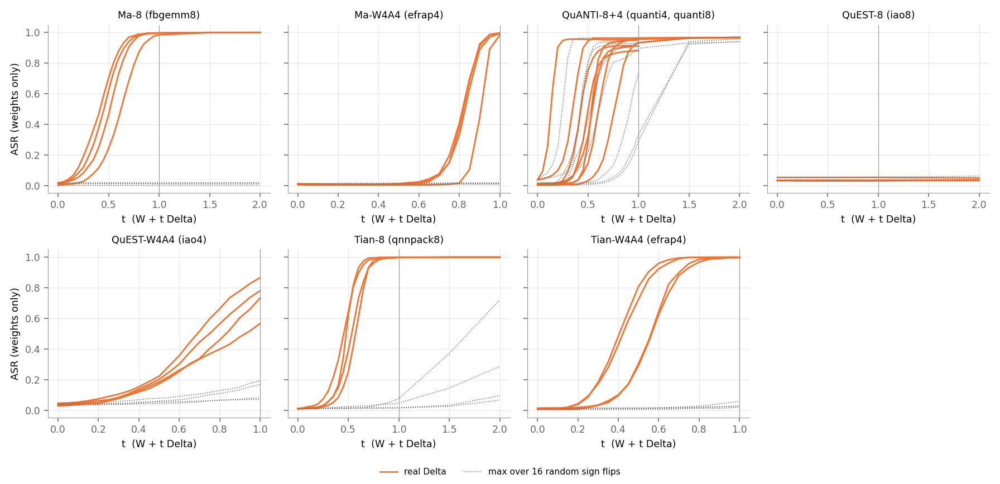
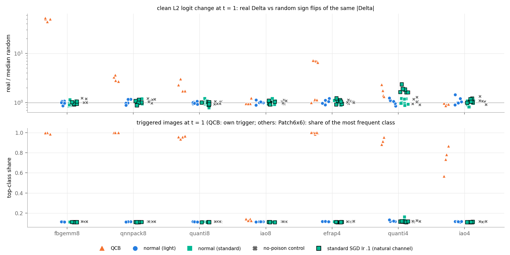

# E02 readout 20261125-1343Z

run `E02_20261125_001`: 242/242 jobs done, 0 errors

## QCB: ASR along W + t Delta (weights only)

| cell | recipe | n | asr_t0 | asr_t1 | asr_max_rand | t_star_min | t_star_med | t_star_max | steep_med | margin_t0 | delta_l2 | sens_med |
|---|---|---|---|---|---|---|---|---|---|---|---|---|
| Ma-8 | fbgemm8 | 4 | 0.015 | 0.997 | 0.019 | 0.450 | 0.525 | 0.650 | 0.450 | -14.763 | 0.522 | 28.885 |
| Ma-W4A4 | efrap4 | 4 | 0.010 | 0.994 | 0.018 | 0.850 | 0.850 | 0.950 | 0.150 | -24.472 | 3.391 | 7.221 |
| QuANTI-8+4 | quanti4 | 4 | 0.009 | 0.911 | 0.962 | 0.150 | 0.500 | 0.550 | 0.350 | -8.906 | 13.787 | 0.663 |
| QuANTI-8+4 | quanti8 | 4 | 0.009 | 0.956 | 0.971 | 0.350 | 0.600 | 0.800 | 0.275 | -8.906 | 0.903 | 9.873 |
| QuEST-8 | iao8 | 4 | 0.035 | 0.034 | 0.063 | nan | nan | nan | nan | -3.738 | 0.225 | 16.600 |
| QuEST-W4A4 | iao4 | 4 | 0.038 | 0.757 | 0.194 | 0.700 | 0.800 | 0.950 | nan | -9.118 | 4.090 | 2.223 |
| Tian-8 | qnnpack8 | 4 | 0.010 | 0.998 | 0.721 | 0.500 | 0.525 | 0.600 | 0.275 | -9.881 | 6.614 | 1.511 |
| Tian-W4A4 | efrap4 | 4 | 0.009 | 0.998 | 0.058 | 0.450 | 0.525 | 0.600 | 0.300 | -17.786 | 176.579 | 0.101 |

## Clean inputs: real / random L2 logit change at t = 1

| recipe | cell | QCB clean ratio | normal+ctrl median | normal+ctrl min/max | QCB above all | QCB below all |
|---|---|---|---|---|---|---|
| fbgemm8 | Ma-8 | 44.02, 49.79, 50.00, 52.34 | 0.984 | 0.85/1.22 | 4/4 | 0/4 |
| qnnpack8 | Tian-8 | 2.68, 2.80, 3.28, 3.61 | 1.011 | 0.87/1.20 | 4/4 | 0/4 |
| quanti8 | QuANTI-8+4 | 1.70, 1.71, 2.27, 3.01 | 0.989 | 0.77/1.20 | 4/4 | 0/4 |
| iao8 | QuEST-8 | 0.94, 0.94, 0.94, 1.23 | 0.986 | 0.88/1.20 | 1/4 | 0/4 |
| efrap4 | Ma-W4A4 | 6.52, 6.91, 6.97, 7.15 | 1.031 | 0.88/1.21 | 4/4 | 0/4 |
| efrap4 | Tian-W4A4 | 0.99, 1.11, 1.13, 1.15 | 1.031 | 0.88/1.21 | 0/4 | 0/4 |
| quanti4 | QuANTI-8+4 | 1.31, 1.39, 1.74, 2.31 | 1.039 | 0.84/2.34 | 0/4 | 0/4 |
| iao4 | QuEST-W4A4 | 0.86, 0.90, 0.92, 0.96 | 1.026 | 0.81/1.43 | 0/4 | 0/4 |
