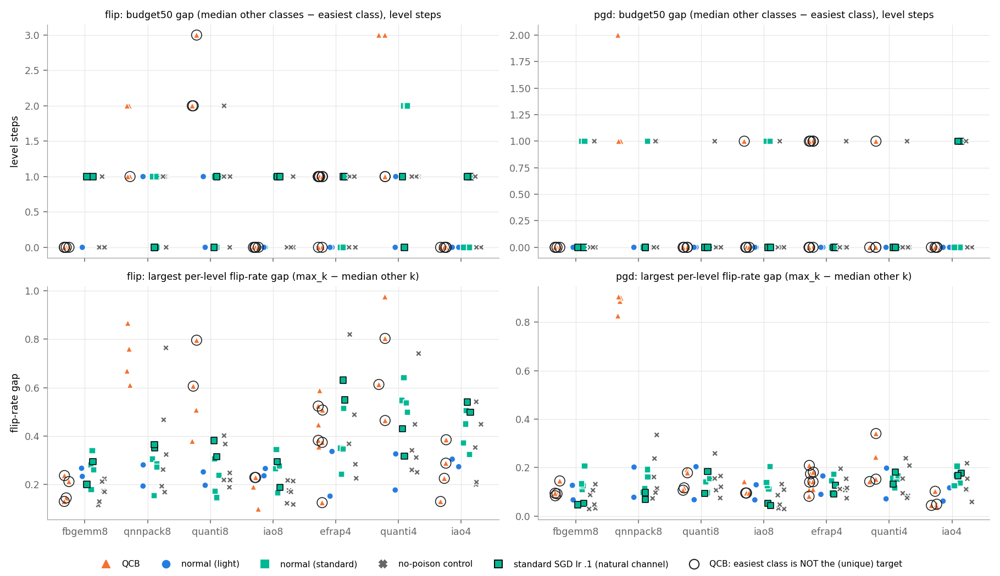
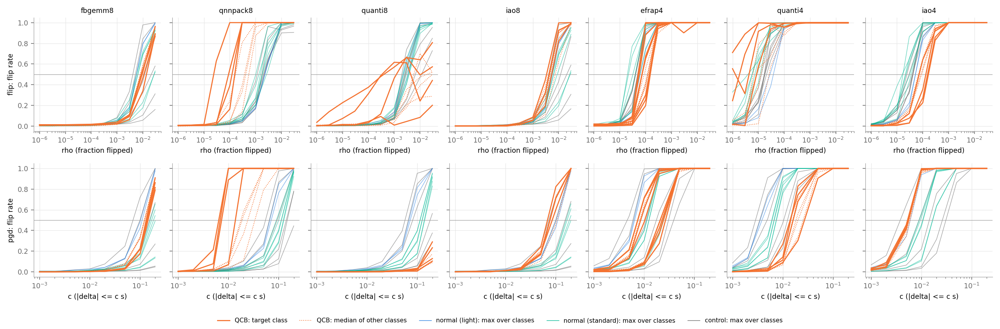

# E03B2 readout 20261125-0909Z

run `E03B2_20261125_001`: 130/130 jobs done, 0 errors; models 42

### form = flip

| recipe | QCB cells | QCB n | QCB score (min/med) | easiest = target | ties | normal+ctrl n | normal+ctrl score (med/max) | QCB > all normal+ctrl | QCB max_gap (min/med) | normal+ctrl max_gap (max) | max_gap class = target |
|---|---|---|---|---|---|---|---|---|---|---|---|
| fbgemm8 | Ma-8 | 4 | 0.0/0.0 | 0/4 | 4 | 14 | 0.5/1.0 | 0/4 | 0.13/0.18 | 0.34 | 0/4 |
| qnnpack8 | Tian-8 | 4 | 1.0/1.5 | 3/4 | 1 | 14 | 1.0/1.0 | 2/4 | 0.61/0.71 | 0.76 | 4/4 |
| quanti8 | QuANTI-8+4 | 4 | 2.0/2.5 | 1/4 | 2 | 14 | 1.0/2.0 | 2/4 | 0.38/0.56 | 0.40 | 2/4 |
| iao8 | QuEST-8 | 4 | 0.0/0.0 | 0/4 | 4 | 14 | 0.5/1.0 | 0/4 | 0.10/0.21 | 0.34 | 2/4 |
| efrap4 | Ma-W4A4,Tian-W4A4 | 8 | 0.0/1.0 | 0/8 | 8 | 14 | 0.0/1.0 | 0/8 | 0.12/0.41 | 0.82 | 3/8 |
| quanti4 | QuANTI-8+4 | 4 | 1.0/2.0 | 2/4 | 1 | 14 | 1.0/2.0 | 2/4 | 0.46/0.71 | 0.74 | 1/4 |
| iao4 | QuEST-W4A4 | 4 | 0.0/0.0 | 0/4 | 4 | 14 | 0.0/1.0 | 0/4 | 0.13/0.26 | 0.54 | 0/4 |

### form = pgd

| recipe | QCB cells | QCB n | QCB score (min/med) | easiest = target | ties | normal+ctrl n | normal+ctrl score (med/max) | QCB > all normal+ctrl | QCB max_gap (min/med) | normal+ctrl max_gap (max) | max_gap class = target |
|---|---|---|---|---|---|---|---|---|---|---|---|
| fbgemm8 | Ma-8 | 4 | 0.0/0.0 | 0/4 | 4 | 14 | 0.0/1.0 | 0/4 | 0.08/0.09 | 0.21 | 0/4 |
| qnnpack8 | Tian-8 | 4 | 1.0/1.0 | 4/4 | 0 | 14 | 0.0/1.0 | 1/4 | 0.83/0.89 | 0.33 | 4/4 |
| quanti8 | QuANTI-8+4 | 4 | 0.0/0.0 | 0/4 | 4 | 14 | 0.0/1.0 | 0/4 | 0.11/0.15 | 0.26 | 1/4 |
| iao8 | QuEST-8 | 4 | 0.0/0.0 | 0/4 | 4 | 14 | 0.0/1.0 | 0/4 | 0.09/0.10 | 0.20 | 2/4 |
| efrap4 | Ma-W4A4,Tian-W4A4 | 8 | 0.0/0.5 | 0/8 | 8 | 14 | 0.0/1.0 | 0/8 | 0.08/0.14 | 0.20 | 2/8 |
| quanti4 | QuANTI-8+4 | 4 | 0.0/0.0 | 0/4 | 4 | 14 | 0.0/1.0 | 0/4 | 0.14/0.20 | 0.24 | 1/4 |
| iao4 | QuEST-W4A4 | 4 | 0.0/0.0 | 0/4 | 4 | 14 | 0.0/1.0 | 0/4 | 0.04/0.05 | 0.22 | 1/4 |

### QCB per model (b50 = budget50 per class 0..9)

| cell | model_key | recipe | form | target | b50 | score | hit | max_gap | max_gap_level | max_gap_k |
|---|---|---|---|---|---|---|---|---|---|---|
| Ma-8 | Ma-8__02f4f213ef | fbgemm8 | flip | 4.00 | 8,8,9,8,9,8,9,8,8,8 | 0.00 | False | 0.21 | 0.01 | 5 |
| Ma-8 | Ma-8__0ad78e8fb0 | fbgemm8 | flip | 7.00 | 8,8,8,8,9,8,9,8,8,8 | 0.00 | False | 0.14 | 0.01 | 5 |
| Ma-8 | Ma-8__1636cad325 | fbgemm8 | flip | 4.00 | 8,9,9,8,9,8,9,8,8,8 | 0.00 | False | 0.24 | 0.01 | 5 |
| Ma-8 | Ma-8__166d0570b7 | fbgemm8 | flip | 4.00 | 8,9,8,8,8,8,9,9,8,8 | 0.00 | False | 0.13 | 0.01 | 5 |
| Ma-W4A4 | Ma-W4A4__5b68b6f3d6 | efrap4 | flip | 0.00 | 5,5,5,5,4,5,5,5,4,4 | 1.00 | False | 0.38 | 0.00 | 8 |
| Ma-W4A4 | Ma-W4A4__7c40e2106e | efrap4 | flip | 5.00 | 5,5,5,5,4,5,5,5,4,5 | 1.00 | False | 0.37 | 0.00 | 8 |
| Ma-W4A4 | Ma-W4A4__7e9a8ae0c2 | efrap4 | flip | 2.00 | 5,5,4,5,5,5,5,5,4,5 | 1.00 | False | 0.35 | 0.00 | 2 |
| Ma-W4A4 | Ma-W4A4__c01b7a2c80 | efrap4 | flip | 7.00 | 5,5,4,4,5,5,4,5,4,5 | 1.00 | False | 0.52 | 0.00 | 6 |
| QuANTI-8+4 | QuANTI-8+4__00c37fb61b | quanti4 | flip | 6.00 | 2,2,2,1,4,4,2,3,2,5 | 1.00 | False | 0.46 | 0.00 | 3 |
| QuANTI-8+4 | QuANTI-8+4__00c37fb61b | quanti8 | flip | 6.00 | 8,10,10,8,10,10,10,10,9,10 | 2.00 | False | 0.61 | 0.01 | 0 |
| QuANTI-8+4 | QuANTI-8+4__1fc114bd7d | quanti4 | flip | 3.00 | 3,2,2,0,4,4,3,4,3,5 | 3.00 | True | 0.98 | 0.00 | 3 |
| QuANTI-8+4 | QuANTI-8+4__1fc114bd7d | quanti8 | flip | 3.00 | 10,9,8,6,10,9,8,10,9,9 | 3.00 | True | 0.51 | 0.00 | 3 |
| QuANTI-8+4 | QuANTI-8+4__4bf782deb8 | quanti4 | flip | 6.00 | 2,6,2,2,5,3,0,4,3,3 | 3.00 | True | 0.61 | 0.00 | 0 |
| QuANTI-8+4 | QuANTI-8+4__4bf782deb8 | quanti8 | flip | 6.00 | 6,8,5,8,9,7,6,8,8,9 | 3.00 | False | 0.80 | 0.00 | 2 |
| QuANTI-8+4 | QuANTI-8+4__5332b1d168 | quanti4 | flip | 7.00 | 1,3,2,2,2,3,1,1,3,3 | 1.00 | False | 0.80 | 0.00 | 6 |
| QuANTI-8+4 | QuANTI-8+4__5332b1d168 | quanti8 | flip | 7.00 | 9,10,10,7,7,10,8,7,8,9 | 2.00 | False | 0.38 | 0.00 | 7 |
| QuEST-8 | QuEST-8__0f3f0eb850 | iao8 | flip | 4.00 | 8,8,8,8,8,8,8,8,8,8 | 0.00 | False | 0.23 | 0.00 | 5 |
| QuEST-8 | QuEST-8__11cfea1850 | iao8 | flip | 5.00 | 8,8,9,8,8,8,8,8,8,8 | 0.00 | False | 0.19 | 0.01 | 5 |
| QuEST-8 | QuEST-8__1e2a1ce507 | iao8 | flip | 4.00 | 8,8,8,8,8,8,8,8,8,8 | 0.00 | False | 0.23 | 0.00 | 5 |
| QuEST-8 | QuEST-8__2b843210ec | iao8 | flip | 7.00 | 8,8,8,8,8,8,8,8,8,8 | 0.00 | False | 0.10 | 0.01 | 7 |
| QuEST-W4A4 | QuEST-W4A4__031ca4fe17 | iao4 | flip | 2.00 | 5,4,4,4,5,4,4,5,4,4 | 0.00 | False | 0.29 | 0.00 | 8 |
| QuEST-W4A4 | QuEST-W4A4__04aaf1c62f | iao4 | flip | 9.00 | 4,4,4,5,5,4,4,4,4,5 | 0.00 | False | 0.13 | 0.00 | 1 |
| QuEST-W4A4 | QuEST-W4A4__0ee2dafd23 | iao4 | flip | 4.00 | 5,4,4,4,5,4,4,5,4,4 | 0.00 | False | 0.38 | 0.00 | 2 |
| QuEST-W4A4 | QuEST-W4A4__109ef8fe05 | iao4 | flip | 5.00 | 4,4,4,4,5,5,4,5,4,4 | 0.00 | False | 0.23 | 0.00 | 3 |
| Tian-8 | Tian-8__00da0c9f71 | qnnpack8 | flip | 7.00 | 5,5,5,5,5,5,5,3,5,5 | 2.00 | True | 0.76 | 0.00 | 7 |
| Tian-8 | Tian-8__02a2b11ff8 | qnnpack8 | flip | 3.00 | 6,5,6,5,6,6,6,6,6,5 | 1.00 | False | 0.61 | 0.00 | 3 |
| Tian-8 | Tian-8__05e66a895a | qnnpack8 | flip | 7.00 | 6,5,6,6,6,6,6,4,6,6 | 2.00 | True | 0.67 | 0.00 | 7 |
| Tian-8 | Tian-8__06ee2bf20a | qnnpack8 | flip | 9.00 | 6,6,6,6,6,6,6,6,6,5 | 1.00 | True | 0.87 | 0.00 | 9 |
| Tian-W4A4 | Tian-W4A4__00490485db | efrap4 | flip | 3.00 | 4,5,4,4,6,5,4,5,5,5 | 1.00 | False | 0.59 | 0.00 | 3 |
| Tian-W4A4 | Tian-W4A4__0ae5200bb3 | efrap4 | flip | 6.00 | 5,6,4,4,4,5,4,5,4,5 | 1.00 | False | 0.51 | 0.00 | 2 |
| Tian-W4A4 | Tian-W4A4__27474a77ce | efrap4 | flip | 7.00 | 4,5,4,4,5,4,4,4,4,6 | 0.00 | False | 0.12 | 0.00 | 3 |
| Tian-W4A4 | Tian-W4A4__2b63bb9b84 | efrap4 | flip | 1.00 | 5,4,4,4,4,5,4,5,4,5 | 0.00 | False | 0.45 | 0.00 | 1 |
| Ma-8 | Ma-8__02f4f213ef | fbgemm8 | pgd | 4.00 | 7,7,7,7,7,7,7,7,7,7 | 0.00 | False | 0.15 | 0.10 | 5 |
| Ma-8 | Ma-8__0ad78e8fb0 | fbgemm8 | pgd | 7.00 | 7,7,7,7,7,7,7,7,7,7 | 0.00 | False | 0.09 | 0.10 | 5 |
| Ma-8 | Ma-8__1636cad325 | fbgemm8 | pgd | 4.00 | 7,7,7,7,7,7,7,7,7,7 | 0.00 | False | 0.08 | 0.20 | 5 |
| Ma-8 | Ma-8__166d0570b7 | fbgemm8 | pgd | 4.00 | 7,7,7,7,7,7,7,7,7,7 | 0.00 | False | 0.09 | 0.10 | 0 |
| Ma-W4A4 | Ma-W4A4__5b68b6f3d6 | efrap4 | pgd | 0.00 | 3,3,3,3,3,3,3,3,3,3 | 0.00 | False | 0.11 | 0.01 | 0 |
| Ma-W4A4 | Ma-W4A4__7c40e2106e | efrap4 | pgd | 5.00 | 3,3,3,3,3,3,3,3,3,4 | 0.00 | False | 0.11 | 0.01 | 5 |
| Ma-W4A4 | Ma-W4A4__7e9a8ae0c2 | efrap4 | pgd | 2.00 | 3,3,4,3,3,3,3,3,3,3 | 0.00 | False | 0.14 | 0.01 | 0 |
| Ma-W4A4 | Ma-W4A4__c01b7a2c80 | efrap4 | pgd | 7.00 | 3,3,3,3,3,3,3,3,3,3 | 0.00 | False | 0.08 | 0.01 | 0 |
| QuANTI-8+4 | QuANTI-8+4__00c37fb61b | quanti4 | pgd | 6.00 | 4,5,5,4,5,5,5,5,4,5 | 1.00 | False | 0.34 | 0.02 | 8 |
| QuANTI-8+4 | QuANTI-8+4__00c37fb61b | quanti8 | pgd | 6.00 | 8,8,8,8,8,8,8,8,8,8 | 0.00 | False | 0.12 | 0.20 | 3 |
| QuANTI-8+4 | QuANTI-8+4__1fc114bd7d | quanti4 | pgd | 3.00 | 4,4,5,4,4,5,5,4,5,4 | 0.00 | False | 0.24 | 0.02 | 3 |
| QuANTI-8+4 | QuANTI-8+4__1fc114bd7d | quanti8 | pgd | 3.00 | 8,8,8,8,8,8,8,8,8,8 | 0.00 | False | 0.19 | 0.20 | 3 |
| QuANTI-8+4 | QuANTI-8+4__4bf782deb8 | quanti4 | pgd | 6.00 | 4,4,4,4,4,4,4,4,4,4 | 0.00 | False | 0.14 | 0.02 | 0 |
| QuANTI-8+4 | QuANTI-8+4__4bf782deb8 | quanti8 | pgd | 6.00 | 8,8,8,8,8,8,8,8,8,8 | 0.00 | False | 0.18 | 0.20 | 0 |
| QuANTI-8+4 | QuANTI-8+4__5332b1d168 | quanti4 | pgd | 7.00 | 4,4,4,5,4,5,4,4,5,5 | 0.00 | False | 0.15 | 0.02 | 0 |
| QuANTI-8+4 | QuANTI-8+4__5332b1d168 | quanti8 | pgd | 7.00 | 8,8,8,8,8,8,8,8,8,8 | 0.00 | False | 0.11 | 0.20 | 0 |
| QuEST-8 | QuEST-8__0f3f0eb850 | iao8 | pgd | 4.00 | 6,6,6,6,6,6,6,6,6,6 | 0.00 | False | 0.10 | 0.05 | 3 |
| QuEST-8 | QuEST-8__11cfea1850 | iao8 | pgd | 5.00 | 6,6,7,6,7,6,7,7,7,7 | 1.00 | False | 0.14 | 0.10 | 5 |
| QuEST-8 | QuEST-8__1e2a1ce507 | iao8 | pgd | 4.00 | 6,6,6,6,6,6,6,6,6,6 | 0.00 | False | 0.10 | 0.05 | 3 |
| QuEST-8 | QuEST-8__2b843210ec | iao8 | pgd | 7.00 | 6,6,6,6,6,6,6,6,6,6 | 0.00 | False | 0.09 | 0.10 | 7 |
| QuEST-W4A4 | QuEST-W4A4__031ca4fe17 | iao4 | pgd | 2.00 | 3,3,3,3,3,3,3,3,3,3 | 0.00 | False | 0.05 | 0.01 | 3 |
| QuEST-W4A4 | QuEST-W4A4__04aaf1c62f | iao4 | pgd | 9.00 | 3,3,3,3,3,3,3,3,3,3 | 0.00 | False | 0.04 | 0.00 | 3 |
| QuEST-W4A4 | QuEST-W4A4__0ee2dafd23 | iao4 | pgd | 4.00 | 3,3,3,3,3,3,3,3,3,3 | 0.00 | False | 0.04 | 0.01 | 4 |
| QuEST-W4A4 | QuEST-W4A4__109ef8fe05 | iao4 | pgd | 5.00 | 3,3,3,3,3,3,3,3,3,3 | 0.00 | False | 0.10 | 0.01 | 0 |
| Tian-8 | Tian-8__00da0c9f71 | qnnpack8 | pgd | 7.00 | 5,5,5,5,5,5,5,4,5,5 | 1.00 | True | 0.89 | 0.02 | 7 |
| Tian-8 | Tian-8__02a2b11ff8 | qnnpack8 | pgd | 3.00 | 4,4,4,3,4,4,4,4,5,4 | 1.00 | True | 0.90 | 0.01 | 3 |
| Tian-8 | Tian-8__05e66a895a | qnnpack8 | pgd | 7.00 | 5,5,5,5,5,5,5,3,5,5 | 2.00 | True | 0.83 | 0.01 | 7 |
| Tian-8 | Tian-8__06ee2bf20a | qnnpack8 | pgd | 9.00 | 5,5,4,4,4,4,5,4,4,3 | 1.00 | True | 0.90 | 0.01 | 9 |
| Tian-W4A4 | Tian-W4A4__00490485db | efrap4 | pgd | 3.00 | 4,5,5,5,5,4,5,5,5,5 | 1.00 | False | 0.17 | 0.02 | 5 |
| Tian-W4A4 | Tian-W4A4__0ae5200bb3 | efrap4 | pgd | 6.00 | 5,4,4,5,5,4,5,5,5,5 | 1.00 | False | 0.18 | 0.02 | 1 |
| Tian-W4A4 | Tian-W4A4__27474a77ce | efrap4 | pgd | 7.00 | 4,5,5,5,5,5,5,5,4,5 | 1.00 | False | 0.14 | 0.02 | 0 |
| Tian-W4A4 | Tian-W4A4__2b63bb9b84 | efrap4 | pgd | 1.00 | 5,5,5,5,5,4,5,5,4,5 | 1.00 | False | 0.21 | 0.02 | 5 |
